<p align="center">
  
</p>

<h1 align="center">sycnUI</h1>

<p align="center">
  <b>AI-Native Interface Design & Prototyping: Autonomous, Collaborative, and Built in Pure Rust.</b><br>
  Design full screens, mobile apps, and design systems with a conversational AI design partner,<br>
  backed by vector networks, auto layout, component marketplace, and production-ready code export.
  <br><i>Powered by Zenuxs.</i>
</p>

<p align="center">
  
  
  
  
</p>

<br>

<p align="center">
  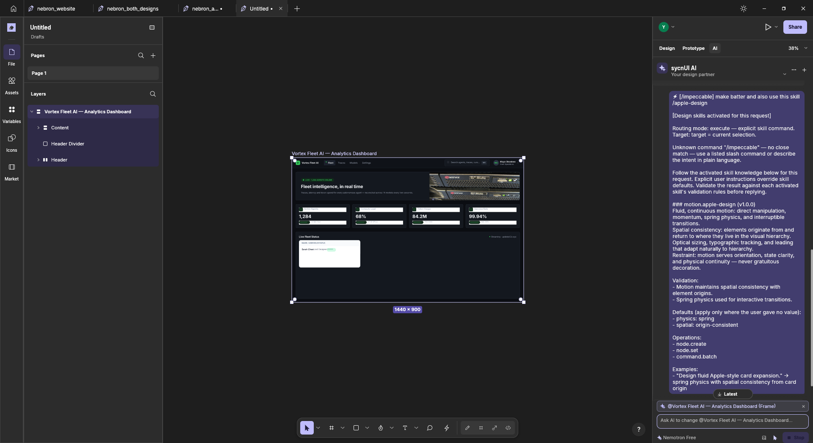
  <br><sub><b>sycnUI AI in action</b>: autonomously building and refining a modern analytics dashboard with live reasoning, Apple design skills, and component marketplace integration</sub>
</p>

<br>

<p align="center">
  <a href="#the-ai-design-partner">AI Design Partner</a> ·
  <a href="#a-look-around">A look around</a> ·
  <a href="#made-in-sycnui">Made in sycnUI</a> ·
  <a href="#features">Features</a> ·
  <a href="#built-for-agents">Agents & CLI</a> ·
  <a href="#under-the-hood">Under the hood</a> ·
  <a href="#get-started">Get started</a> ·
  <a href="#privacy-and-online-sharing">Privacy & Sharing</a>
</p>

<br>

<table>
  <tr>
    <td width="25%" valign="top">
      <h3>🤖 AI-First Design</h3>
      A conversational AI design partner built directly into the editor. Generate complete screens, redesign containers with <code>@Mentions</code>, and steer generation with slash skills like <code>/apple-design</code>.
    </td>
    <td width="25%" valign="top">
      <h3>🧩 Component Market</h3>
      Integrated ecosystem with 100+ production components from <code>@shadcn</code>, <code>@originui</code>, <code>@kibo</code>, and <code>@cult</code>, ready to insert or style via AI with a single click.
    </td>
    <td width="25%" valign="top">
      <h3>⚡ Native Rust Engine</h3>
      A pure Rust engine with a persistent document model. Edits and AI modifications touch only what changed — zero lag, instant startup, no Electron, and no web views.
    </td>
    <td width="25%" valign="top">
      <h3>🔌 Offline and Private</h3>
      Your files are plain local archives on your disk. No telemetry, no cloud dependency, and complete privacy for your designs and AI prompts.
    </td>
  </tr>
</table>

<br>

## The AI Design Partner

sycnUI brings autonomous generative interface design directly to the vector canvas. Instead of producing flat mockup images, the AI operates sycnUI's native command engine to construct real layers, auto-layout frames, text styles, and component instances.

<table>
<tr>
<td width="50%" valign="top">
  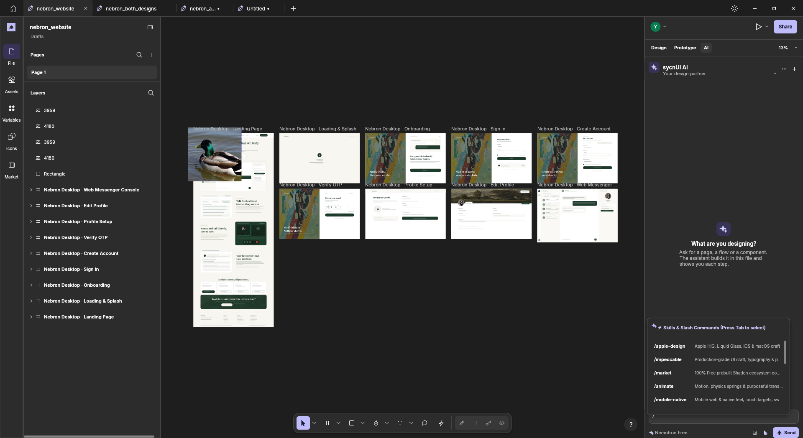
  <p align="center"><sub><b>Slash Commands & Skills</b>: steer AI with curated design guidelines like <code>/apple-design</code>, <code>/impeccable</code>, and <code>/mobile-native</code></sub></p>
</td>
<td width="50%" valign="top">
  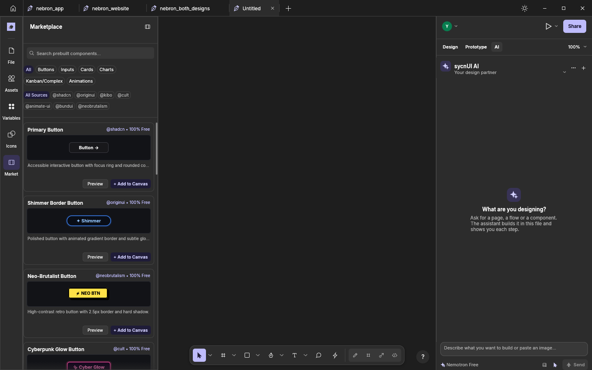
  <p align="center"><sub><b>Component Marketplace</b>: browse and insert buttons, cards, charts, and tables from <code>@shadcn</code> and <code>@originui</code> directly to canvas</sub></p>
</td>
</tr>
</table>

### Core AI Capabilities

- **Natural Language to Full UI**: Prompt the AI to build complete responsive screens, mobile applications, web dashboards, or marketing pages from scratch with high-contrast typography, harmonious color ramps, and auto layout.
- **Precision Redesign with `@Mention`**: Select or `@Mention` any container on your canvas (e.g. `@Hero Card`, `@Login Screen`). sycnUI AI cleans obsolete child elements with `clear_node_children` and rebuilds the contents in place, preserving coordinates, dimensions, and auto-layout settings.
- **Isolated Per-Tab AI Sessions**: Every document tab holds its own independent conversation history, composer draft, and background streaming. You can prompt the AI in one tab and immediately switch to another tab without interrupting or corrupting background generation.
- **Design System Skills via Slash Commands**: Trigger curated design engineering frameworks with slash commands:
  - `/apple-design` — Apple Human Interface Guidelines, Liquid Glass, iOS & macOS craft.
  - `/impeccable` — Production-grade UI craft, typographic scale, and polish.
  - `/market` — Component-first workflow utilizing prebuilt accessible components.
  - `/animate` — Motion curves, physics springs, and purposeful micro-interactions.
  - `/mobile-native` — Native touch targets, bottom sheets, and mobile UX.
- **Prompt Iteration & History**: Easily edit previous prompts, copy text, or revert the conversation back to any turn with dedicated quick-action buttons under every message.

<br>

## A look around

<table>
<tr>
<td width="50%" valign="top">
  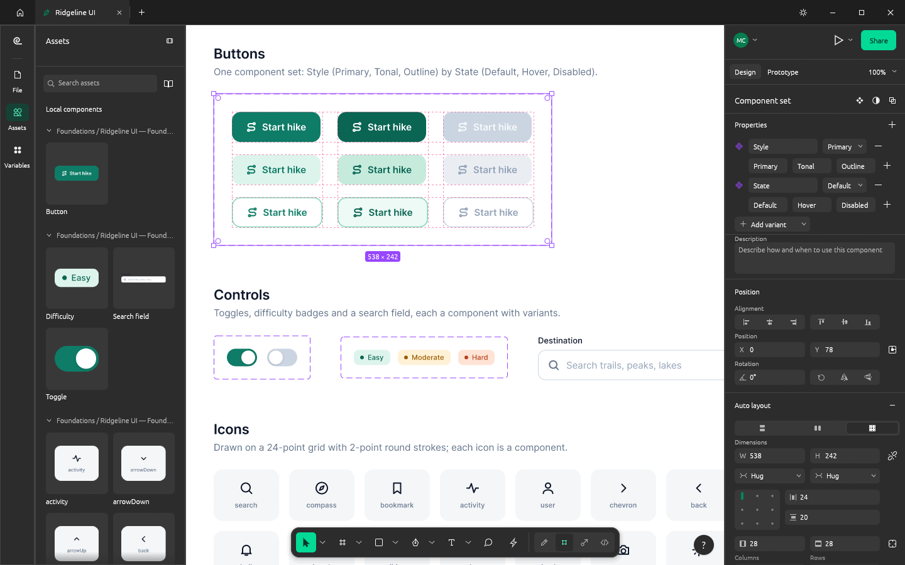
  <p align="center"><sub><b>Components and variants</b>: component sets, variant properties and the Assets panel · <code>examples/ridgeline-design-system</code></sub></p>
</td>
<td width="50%" valign="top">
  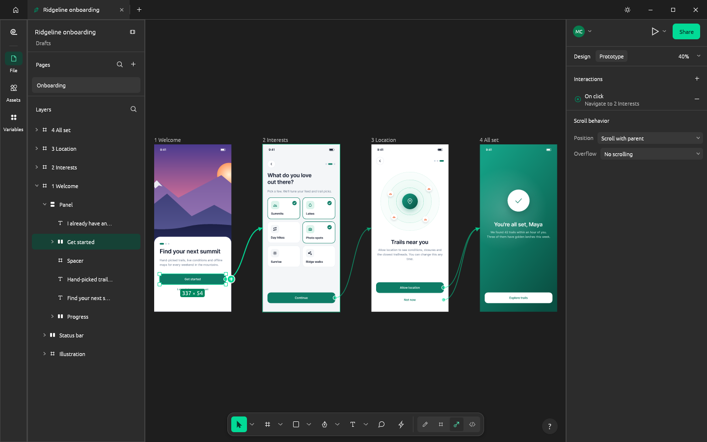
  <p align="center"><sub><b>Prototyping</b>: connections, transitions, back actions and a flow · <code>examples/ridgeline-onboarding</code></sub></p>
</td>
</tr>
<tr>
<td width="50%" valign="top">
  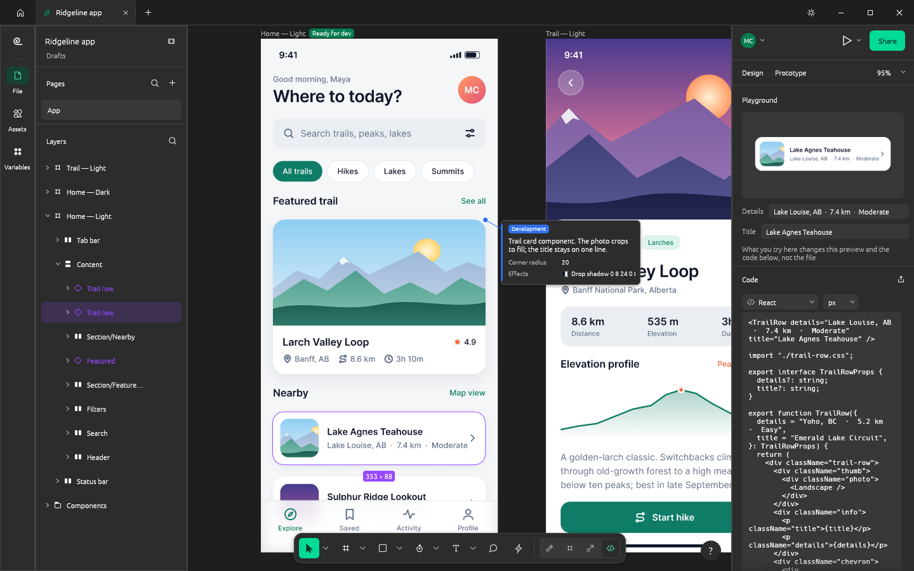
  <p align="center"><sub><b>Developer Mode</b>: ready-for-dev status, annotations and React code where component properties become props · <code>examples/ridgeline-app</code></sub></p>
</td>
<td width="50%" valign="top">
  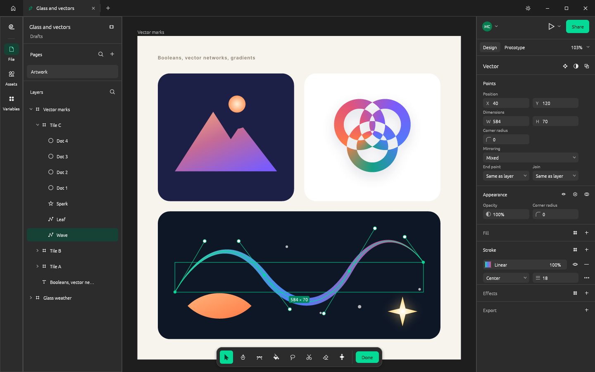
  <p align="center"><sub><b>Vector networks</b>: points and handles, variable-width strokes, booleans that stay editable · <code>examples/glass-and-vectors</code></sub></p>
</td>
</tr>
<tr>
<td width="50%" valign="top">
  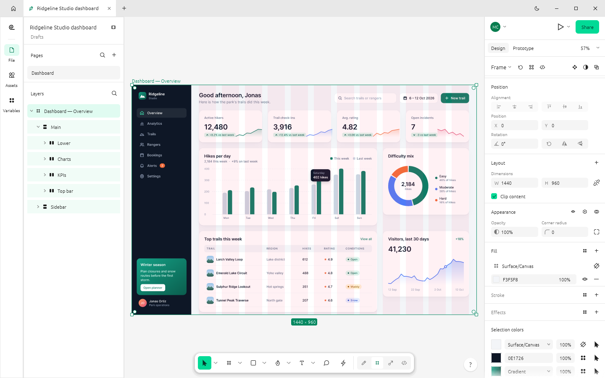
  <p align="center"><sub><b>Layout grids and styles</b>: a 12-column grid, paint, text, effect and grid styles, charts drawn from shapes · <code>examples/ridgeline-studio-dashboard</code></sub></p>
</td>
<td width="50%" valign="top">
  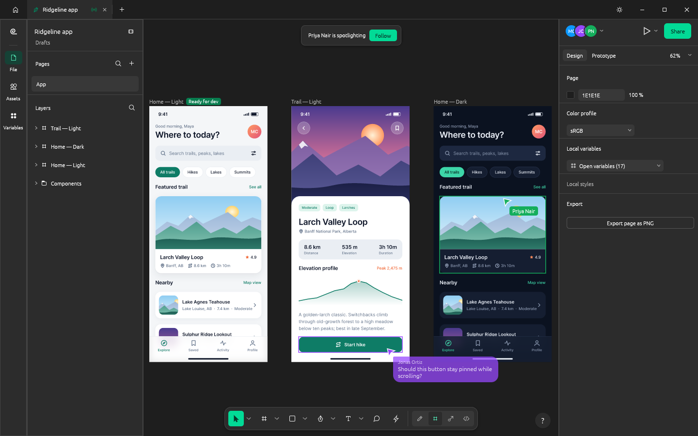
  <p align="center"><sub><b>Live sessions</b>: multi-user collaboration with cursors, selections, cursor chat and spotlight</sub></p>
</td>
</tr>
<tr>
<td width="50%" valign="top">
  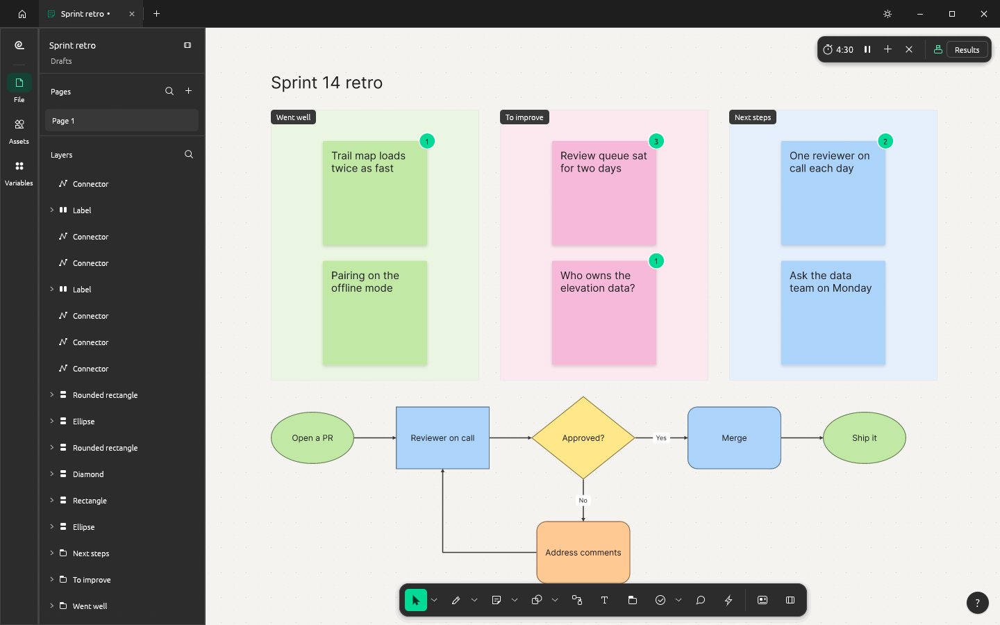
  <p align="center"><sub><b>Boards</b>: a whiteboard file kind with sticky notes, templates, connectors, a shared timer and voting</sub></p>
</td>
<td width="50%" valign="top">
  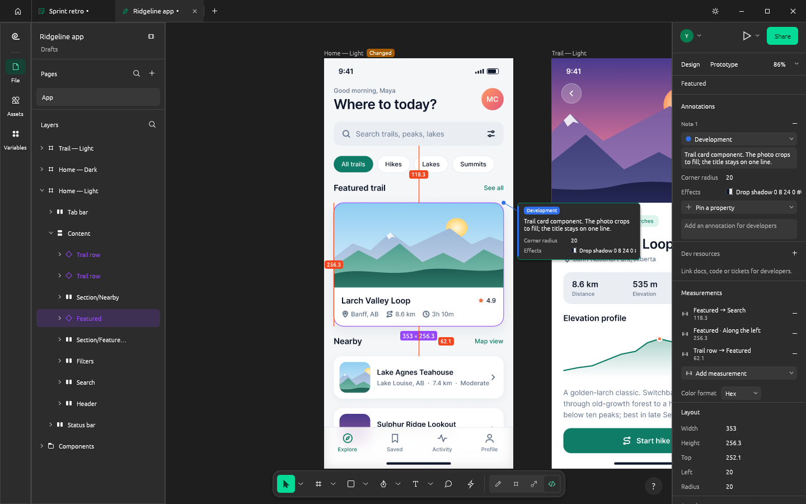
  <p align="center"><sub><b>Developer Mode measurements</b>: redlines placed between layers or along a side, saved in the file · <code>examples/ridgeline-app</code></sub></p>
</td>
</tr>
</table>

## Made in sycnUI

Every design below was built entirely through sycnUI's command API, the same one the MCP server
exposes to agents, and exported at 2x by sycnUI's own renderer. The source files are in
[`examples/`](examples).

<table>
<tr>
<td width="33%" valign="top">
  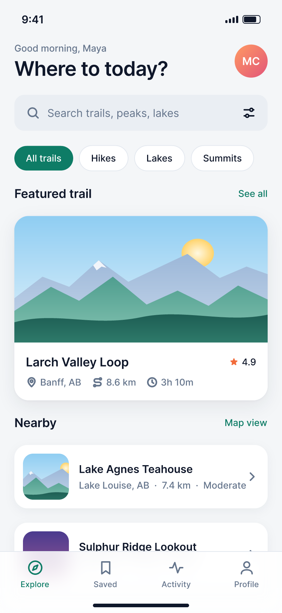
  <p align="center"><sub><b>Home, light</b></sub></p>
</td>
<td width="33%" valign="top">
  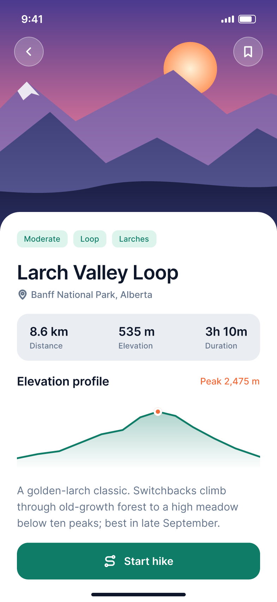
  <p align="center"><sub><b>Trail detail</b></sub></p>
</td>
<td width="33%" valign="top">
  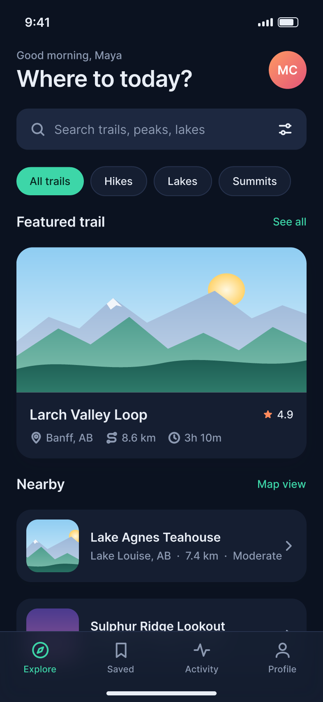
  <p align="center"><sub><b>Home, dark</b>: the same frame in the Dark mode</sub></p>
</td>
</tr>
<tr>
<td colspan="3" valign="top">
  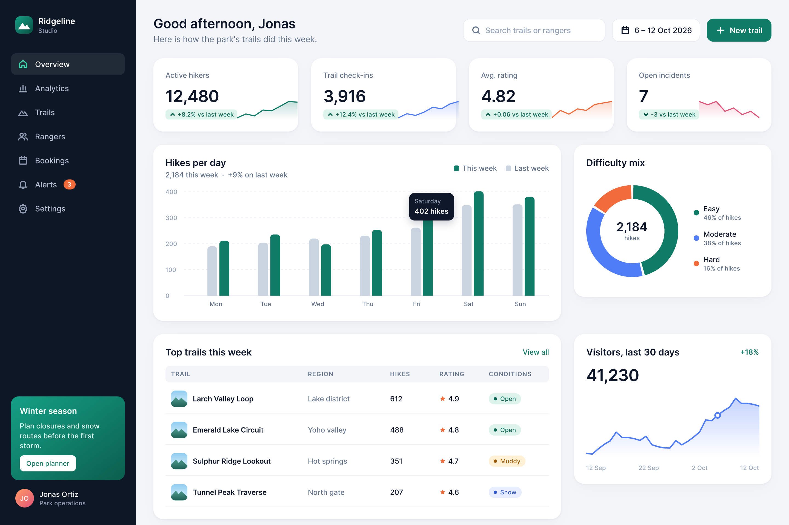
  <p align="center"><sub><b>Ridgeline Studio</b>: a desktop dashboard on a 12-column grid, every chart made of shapes and vectors</sub></p>
</td>
</tr>
<tr>
<td colspan="2" valign="top">
  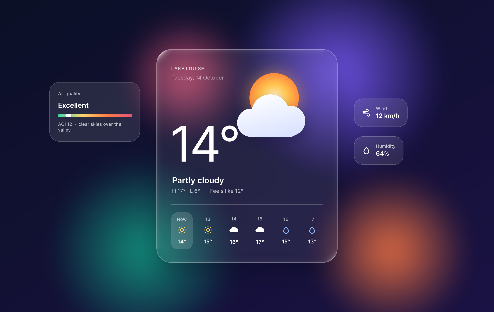
  <p align="center"><sub><b>Glass weather</b>: glass and background blur, layer-blurred colour fields, a boolean cloud</sub></p>
</td>
<td width="33%" valign="top">
  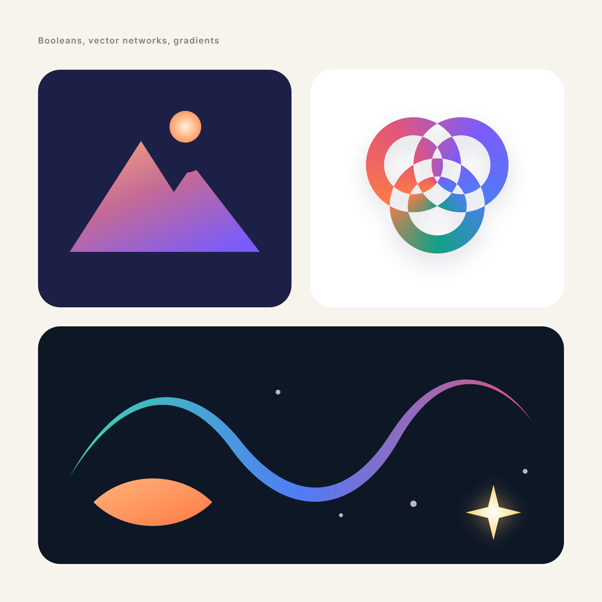
  <p align="center"><sub><b>Vector marks</b>: union, subtract and exclude, an angular gradient, a variable-width stroke</sub></p>
</td>
</tr>
<tr>
<td colspan="3" valign="top">
  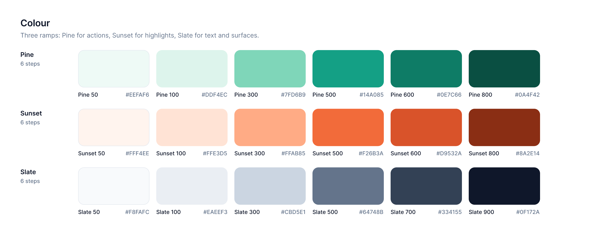
  <p align="center"><sub><b>Design System</b>: colour ramps where every swatch is a paint style, exported through a slice</sub></p>
</td>
</tr>
</table>

## Features

<table>
  <tr>
    <td width="50%" valign="top">
      <h3>Layouts that build themselves</h3>
      Auto layout in both directions, with wrap and grid (fixed, hug and `fr` tracks, cells that span), padding, gaps, alignment including text baselines, Hug / Fill / Fixed sizing, min and max sizes, absolute positioning, drag handles for padding and spacing right on the canvas, and arrow keys that move children through the flow, grid cells and nested frames. Constraints and layout grids for everything else.
    </td>
    <td width="50%" valign="top">
      <h3>Components that scale</h3>
      Main components, instances with overrides that survive edits, component sets with variants, properties, swap instance, detach, reset overrides and go to main component, and an Assets panel with live thumbnails, search and drag-to-canvas into frames and auto layout. Local styles and variables (colour, number, string, boolean) with modes, aliases and scopes, edited in a Variables table and bound to fills, strokes, effects, layout grids and instance properties. Fills, strokes, effects and layout grids reorder by dragging their rows.
    </td>
  </tr>
  <tr>
    <td width="50%" valign="top">
      <h3>Vectors without compromise</h3>
      Real vector networks: the Pen and Pencil tools, vector edit mode with its own tools (pen that extends and branches paths, bend, paint bucket fills for any closed area, lasso, cut), point panel with handle mirroring and per-point corner radius, join, split and heal-on-delete, the shape builder (click or drag across the regions of overlapping shapes, strokes and open paths to merge them, Alt to remove them), boolean groups (union, subtract, intersect, exclude) whose operands stay editable on the canvas with the result following every drag, an operation per operand, flatten, outline stroke, arrowheads, dashes, per-side strokes and variable width strokes (width profile presets, and a Variable width tool that drags width points along the path, one side at a time with Alt). Rectangles with smooth (squircle) corners, polygons, stars, and arcs and rings shaped with on-canvas sweep, start and ratio handles or the Design panel's Arc fields.
    </td>
    <td width="50%" valign="top">
      <h3>Paints and effects</h3>
      Solid, linear, radial, angular and diamond gradients with on-canvas handles, image fills (fill, fit, crop, tile) with adjustments and presets, multiple fills and strokes, every blend mode, drop and inner shadows (spread offsets the outline exactly), layer and background blur (uniform or progressive), noise (mono, duo, multi), texture and glass (refraction, dispersion, frost, light), masks. Files are sRGB or Display P3, with exports tagged with the file's colour profile.
    </td>
  </tr>
  <tr>
    <td width="50%" valign="top">
      <h3>Type that sets beautifully</h3>
      Text edited in place on the canvas (with inline IME composition), mixed styles within a paragraph, auto width and auto height, line height, letter and paragraph spacing, decoration, case, lists, OpenType features, variable font axes and text styles, right-to-left and mixed-direction text (Arabic, Hebrew) with the Unicode bidi algorithm, shaped with HarfRust and the open fonts from craft-fonts plus your system fonts.
    </td>
    <td width="50%" valign="top">
      <h3>Prototype and hand off</h3>
      Connections, triggers, actions and Smart Animate-style transitions, variables with conditionals (if / else if / else built in the interaction editor, expressions like <code>count + 1</code>), flows, a presentation view with device frames, hotspot hints and an Inspect panel, and a live preview pane. Alt to measure distances and padding on the canvas, Inspect mode with measurements, annotations in colour-coded categories, a ready-for-dev list with a focus view and Compare changes (before / after with property-level diffs since a frame was marked ready), and code (CSS, HTML, React, Vue, Leptos, SwiftUI, Compose, ArkUI, Flutter) where components take their properties as parameters, comment threads pinned to frames (replies, @mentions, reactions, read state) and named version history. Export any layer at any scale to PNG, JPG, WebP, SVG or PDF.
    </td>
  </tr>
</table>

<br>

## Built for agents

Every menu item, tool and gesture runs a command from one registry of 400+ commands. The UI, the CLI, the JSON control channel and the MCP server all call the same commands, so anything you can click, a script or an AI agent can do too.

```sh
# Headless: render and export
sycnui-cli render landing.sycnui -o landing.png --scale 2
sycnui-cli export landing.sycnui -o out/ --format svg

# Run a script of commands without a window
sycnui-cli run build-card.json --out card.sycnui

# Every command, with its parameters
sycnui-cli commands --filter autoLayout

# Let an agent drive it over MCP (headless, or attached to the running app)
sycnui-cli mcp
sycnui-cli mcp --attach 47800
```

The desktop app also offers a loopback-only control channel (`sycnui --control <port>`) for inspecting UI state, driving tools with pointer and key events, and taking screenshots. See [`docs/control-protocol.md`](docs/control-protocol.md), [`docs/mcp.md`](docs/mcp.md) and [`docs/cli.md`](docs/cli.md).

## Under the hood

- **Engine first:** a pure-data document model and a command engine, with a thin, swappable egui UI on top. Layering is checked at build time across the workspace crates (`cargo xtask layers`).
- **Persistent data:** the document lives in an immutable ordered map, so undo snapshots are cheap and layout, component sync and text measurement only revisit what changed.
- **Its own renderer:** tiny-skia on every core for the canvas and exports, with layer blending, effects and masks; booleans from linesweeper, geometry from kurbo, text from skrifa and HarfRust.
- **Runs in the browser:** the whole engine and UI compile to WebAssembly.
- **Accessible:** screen readers get names, roles, values and states for the tools, layer rows, fields, dropdowns, tabs and menus (AccessKit on desktop), F6 moves the keyboard between the toolbar, layers, canvas and properties (Tab within them, Escape back to the canvas), the system's reduce-motion setting is honoured, and panel text meets WCAG AA contrast in both themes.
- **Languages:** English, Russian and Turkish (reviewed by native speakers), and Spanish, French, German, Brazilian Portuguese, Japanese, Korean, Simplified Chinese, Czech, Indonesian, Georgian, Vietnamese and Bosnian drafts, picked in Preferences or taken from the system or browser and switched live; adding a language is one catalog file ([`docs/translating.md`](docs/translating.md)).
- **Plugins:** sandboxed WebAssembly plugins (a metered, pure-Rust interpreter with a memory cap and no file or network access, in the browser too) that act through the same commands, each run one undo step, within the permissions their manifest asks for. A Rust SDK and four example plugins are in [`plugins/`](plugins); see [`docs/plugins.md`](docs/plugins.md).
- **Live sessions (preview):** share the open file from the app (Share ▸ Start sharing: online through a server, or on your local network), give the others the short join code it shows (or the invite link), and edit it together: everyone's changes sync live, with cursors, selections, avatars and follow, and undo takes back only your own changes. Others join from the desktop app (invite links open it) or from the browser build. See [`docs/collab-protocol.md`](docs/collab-protocol.md).
- **A server of your own (preview):** `sycnui-server` keeps a team's files, publishes them from the app (File ▸ Publish to server…, or Share ▸ Online with your server in Preferences) and hands out share links and join codes that let people edit or only view; files survive restarts and apps reconnect where they were. No accounts yet: links are the access. Releases ship it for Linux, and the desktop app joins over `wss://`; [hosting it on a rented Linux server](docs/server.md#deploy-on-a-linux-server) takes a systemd unit and Caddy or nginx (or Docker). See [`docs/server.md`](docs/server.md).
- **Never crashes:** no `unwrap`, `expect` or `panic` in shipped code, enforced by clippy; commands run behind a guard so a bug fails one action, not your session.
- **Clean-room:** implemented from public documentation and observed behaviour only. No proprietary code, file formats, icons or images.

## Get started

```sh
git clone https://github.com/Azaz-Gori07/Zenuxs-Design.git
cd Zenuxs-Design
cargo run --release -p figcraft            # the desktop app
cargo run --release -p figcraft-server     # the collaboration server (docs/server.md)
cargo test --workspace                     # the test suite
cargo xtask ci                             # fmt, clippy, tests, layering and asset checks
```

Fonts for the UI and the Text tool come from [craft-fonts](https://github.com/storytold/craft-fonts), cloned next to this repository (`../craft-fonts`); without it sycnUI falls back to your system fonts.

```sh
git clone https://github.com/storytold/craft-fonts ../craft-fonts
```

If you clone it after a first build, run `cargo clean -p figcraft-text` once so the next build embeds the fonts.

**Start from a template.** The home screen's Templates tab has eight starter files (a mobile app, a landing page, a dashboard, a design system starter, a wireframe kit, social post sizes, presentation slides and an icon set starter), also under File ▸ New from template…. They are built in code from original, synthetic content, so scripts and agents can open them too: `file.newFromTemplate {template}` ([`docs/mcp.md`](docs/mcp.md#starter-templates)).

For the web build, install [trunk](https://trunkrs.dev/) and run `cargo xtask wasm`.

New contributors and AI agents: start with [`AGENTS.md`](AGENTS.md), then [`docs/`](docs/).

Installers for macOS (universal, signed and notarized), Windows (x64, x86 and arm64), Linux (AppImage, `.deb`, `.rpm`, Flatpak and tarball), FreeBSD and the web are attached to each [GitHub release](https://github.com/Azaz-Gori07/Zenuxs-Design/releases). Maintainers: [`docs/releasing.md`](docs/releasing.md) explains how releases are built, signed and published.

> [!IMPORTANT]
> **Status:** sycnUI is in **alpha**: about 49% of the way to replacing proprietary tools for real work, by our own estimate. Nearly all tracked interface design actions in the menu checklist are wired ([`docs/parity-checklist.md`](docs/parity-checklist.md)) and the core editor works end to end, but sycnUI opens `.fig` files only best effort, has only a first preview of multiplayer (live sessions hosted from the app or a self-hosted server, with per-person undo and share links to edit or to view; no accounts, teams or cloud yet), runs its own WebAssembly plugins, and hasn't been checked against real design documents. The honest, area-by-area picture is in the [roadmap](ROADMAP.md) and [`docs/target-app-parity.md`](docs/target-app-parity.md). Expect rough edges and please file issues.

## Privacy and online sharing

sycnUI works offline: it has no account and no telemetry, and it contacts no server until you
share or join a file. Live sessions are a **preview**. Before you share anything that matters,
know what sharing does:

- **Share ▸ Online uploads the file to a server.** By default that is the public server at
  `collab.craftapps.dev`; you can set another one, or your own, in Preferences (and a build can
  ship without it: [`docs/releasing.md`](docs/releasing.md#the-default-server)). The file stays on
  the server after you stop sharing, until you remove it (Share ▸ Advanced ▸ Remove from server…)
  or nobody has opened it for 30 days, when a public server deletes it.
- **It is not end-to-end encrypted.** The connection to the server is encrypted (TLS), but the
  server stores the file unencrypted and whoever runs the server can read it. Don't share
  confidential work through a server you don't trust; run your own
  ([`docs/server.md`](docs/server.md)) or share on the local network instead.
- **The code or link is the access.** There are no accounts: anyone who has an edit code or link
  can open and change the file, anyone with a view code or link can open it. Stop sharing revokes
  them and disconnects everyone else.
- **Share ▸ Local network involves no server**, but it is not encrypted either: your app hosts
  the session and others connect to it directly, so use it on networks you trust.
- **No guarantees.** The public server is offered as is, without backups or uptime promises, and
  files on it can be removed. Keep your own saved copy of anything you share.

The default server's terms are in [`docs/online-sharing-terms.md`](docs/online-sharing-terms.md).

---

## License and credits

sycnUI is dual-licensed under [MIT](LICENSE-MIT) or [Apache-2.0](LICENSE-APACHE), at your option.
Copyright (c) 2026 Zenuxs Team and contributors. Required notices are in [NOTICE](NOTICE).

Every icon in sycnUI is drawn in code or made for this project, and bundled fonts, images and other
assets keep their own open licenses; each one is listed with its author, source and license in
[ATTRIBUTION.md](ATTRIBUTION.md).

## Star history

[](https://www.star-history.com/?repos=Azaz-Gori07%2FZenuxs-Design&type=date&legend=top-left)
